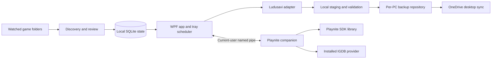

# Architecture

Game Save Manager separates discovery, save protection, and Playnite's library ownership. The app's own working state stays outside the synced folder. OneDrive only sees published artifacts.

## Components

- `GameSaveManager.App`: .NET 10 WPF UI, tray icon, startup setting, dialogs, and diagnostic modes.
- `GameSaveManager.Core`: discovery, local SQLite persistence, scheduler, Ludusavi process adapter, staged repository publication, restoration, and Playnite migration commands.
- `GameSaveManager.Contracts`: .NET Standard 2.0 versioned DTOs shared by the app and companion.
- `GameSaveManager.Playnite`: .NET Framework 4.6.2 generic extension using Playnite SDK 6.17.0. All live library writes happen through the SDK inside Playnite.

## State and concurrency

Default state is `%LOCALAPPDATA%\GameSaveManager`. `state.db` stores settings, discovered installations, confirmed rules, pending bridge work and recent activity. Game installations have stable IDs independent of Playnite's IDs. Pending imports survive restarts; the companion stores its own acknowledgement ledger.

The controller serializes user/background operations. The backup service additionally serializes archive mutations. Long-running work must not reconfigure the engine concurrently. UI lists reload persisted snapshots; status updates are dispatched onto the WPF thread.

The companion polls every 15 seconds. Its pipe name includes the current Windows SID, and the server uses `PipeOptions.CurrentUserOnly`. Commands are versioned and exchanges are bounded by timeouts. Processes use argument lists rather than shell-built command strings.

## External tools

Ludusavi 0.31.0 has a separate configuration and cached manifest in app state. Preview, backup, restore, list and pin operations use its supported command-line interface. Nonzero exit codes, operation errors and per-file failures are treated as incomplete operations.

The app does not sign in to OneDrive or operate a separate cloud synchronization backend. Its cloud status remains unverified. The self-contained Windows build bundles its .NET runtime; the companion uses the runtime supplied by Windows/Playnite.
