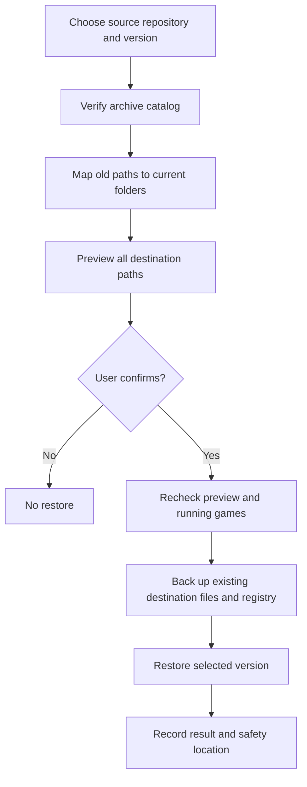

# Backup and recovery

**Status:** experimental · **Added:** 2026-09-12

## What is protected

Ludusavi's known file and registry locations, including game settings and saves from uninstalled games, plus confirmed custom rules. Standard Steam paths are added from local configuration; discovered installation parents extend the engine's roots. Game binaries are not a default backup source.

Custom rules require existing absolute file/folder paths or full registry paths. Do not select an entire user profile or game installation when only its save directory is needed. Rules cannot contain the app state or backup destination.

Use **Inspect files** to see what was actually located. Recognizable configuration-only results are marked **Settings only; saves unverified**, including after those settings are backed up. This detection is conservative, not a complete classification of every game's file formats. A successful copy of found files does not prove that all gameplay progress has been located.

## Layout and retention

```text
Game Save Backups/
  PC-name-unique-id/
    machine.json
    app-configuration.json       # written by Prepare migration
    Saves/
      <Ludusavi per-game directories and mapping.yaml files>
      gsm-integrity.json
    Safety/
      <restore timestamp and unique ID>/
        <native safety backup and restore journal>
    Playnite/
      Routine/
      Pinned/
```

The app asks Ludusavi for full ZIP backups with deflate compression, no differentials and ten unpinned retained versions. Pinned backups do not count against the limit. An unchanged save does not create a new version. Removing a game installation does not remove its backup history.

## Publication and integrity

Backups are serialized. The current per-PC repository is copied into local staging; Ludusavi operates there. Archive entries are read for validation, and published files receive SHA-256 entries in an integrity catalog. Payload files are published before YAML mappings. Each file replacement is atomic, and obsolete tracked files are pruned only after the new catalog is written.

This implementation stages the repository by copying it. That intentionally favors simple recovery over disk efficiency, but needs free local space roughly equal to the existing repository plus the new backup. The first release does not use filesystem snapshots or deduplicated storage.

Running recognized games and busy/recently modified files are deferred. File size/time changes during a backup reject publication. Registry saves cannot be guarded with a filesystem lock; use the post-game backup flow.

Generic installation roots are scanned only for identified games; a separate pass scans account and Steam locations for the complete manifest. This avoids multiplying every manifest entry across every nested game root. If the extra account-wide pass exceeds 90 seconds, results for identified installations are retained and a Deferred coverage entry explicitly reports the incomplete scan. The status bar has Cancel operation, child processes have a ten-minute timeout, and Back up selected limits work to one save entry.

Publication is not atomic across every file or across OneDrive clients. A crash during publication can leave the destination failing its catalog verification; preserve it and run a new successful backup from the source PC before restoring. Cloud upload completion must be checked in OneDrive. Keep the complete per-PC folder, including mapping and integrity files.

## Restoring saves



1. Select the source PC's **Saves** folder and load versions.
2. Choosing it with Browse reads `machine.json` and suggests profile/Documents redirects. Add mappings for changed game drives. More specific mappings take precedence.
3. Select a backup, click **Preview restore**, and inspect every destination. Changing the repository, version or mapping requires another preview.
4. Close games and confirm restoration. The preview is rechecked immediately before a safety backup and restore.
5. Review Recent activity for the result and safety repository location.

To recover overwritten data, choose the recorded **Safety** repository and restore its `Before restore - ...` version. The journal lists files that did not exist before restoration; recovery of the safety archive does not automatically delete those newly created files. No automatic rollback is claimed after a partial restore.

## Moving PCs

On the old PC, resolve coverage gaps, close games, and choose **Prepare migration**. Latest available versions are pinned, custom rules and identities are exported, and a complete Playnite package is created. Unresolved/no-save entries remain in the coverage summary. Verify OneDrive finishes uploading.

On the new PC, install the app and Playnite, make the source folder available locally, choose the source Saves repository, and map old paths. Install game files separately. Restore saves explicitly. Import custom rules after mapping their file locations and confirming the preview. Rescan/review local installations.

Restore the separate Playnite ZIP to preserve its library and customization. The app creates a current-library safety package first and uses Playnite's supported `--restorebackup` command. This can restart Playnite. Check Playnite's result: this action is reported as requested, not falsely marked complete. Reconnect installation paths through the companion after restoring the library. Third-party integrations may require signing in again.

## Routine Playnite packages

With Playnite closed, **Configure Playnite routine backups** safely edits its existing settings to enable complete daily startup backups, retain three copies, and use the chosen destination. The prior settings JSON is saved in local app state. The tray app validates completed routine ZIPs and records hashes; pinned migration packages are separately validated when created.

Source data is never deleted by backing up. The app does not provide automatic two-way synchronization or cross-platform save conversion.
