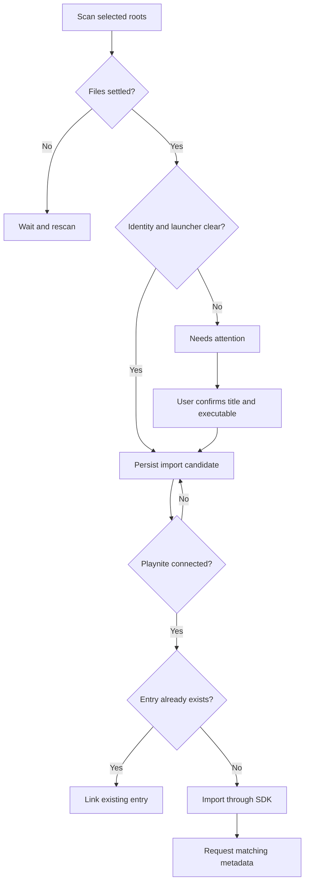

# Discovery and Playnite

**Status:** experimental · **Added:** 2026-09-12

## What it does

Searches selected game collections recursively, keeps corrections, and queues clear or explicitly confirmed installations for Playnite. Adding overlapping folders does not duplicate scans.

## Identification

Directory junctions, extraction directories, redistributables, engine utilities, update folders and common installer/crash executables are skipped. Nested executable groups beneath a launchable parent installation become alternative executables for that game. Generic `game`, `bin`, `Binaries`, `Win64` and `Retail` folders are resolved to their containing game where possible.

Titles are normalized conservatively: separators and version/build suffixes are cleaned while sequel numbers and edition names are preserved. Automatic confirmation requires a unique save-database match plus agreeing executable product metadata. Executables are read as metadata and never launched for identification.

Folder watching is complemented by startup/daily scans. Recent writes defer identification. Missing installations and excluded games retain their stored identities and old backups.

## Companion behavior

The companion reconciles installation paths and stable import IDs before adding anything. Existing titles, notes, artwork and launch arguments are retained. Removing an imported game in Playnite prevents silent recreation via the acknowledgement ledger.

New games get a launch action and installation path. Background metadata uses the installed IGDB provider. Its returned title must agree after punctuation/case normalization. Description, cover and background fill empty fields only. Errors or uncertain matches appear in the app; use Retry metadata after correcting the title or selecting metadata in Playnite.

The restore screen can queue installation and executable remapping using `original folder | new folder` lines. The companion validates all destinations before applying changes. It does not rewrite arbitrary embedded paths in command arguments or third-party launcher configuration.

## Limits

Executables with no useful product metadata usually require one review. Differently named editions can need a corrected title or custom save rule. Engines, mods and collections with unconventional layouts may need manual selection. Distinct installations with the same name are retained as distinct installations; their save engine identity can still be shared.

The real-library discovery pass is read-only. Its report is a list of installation candidates, not a claim that all their saves are protected.
